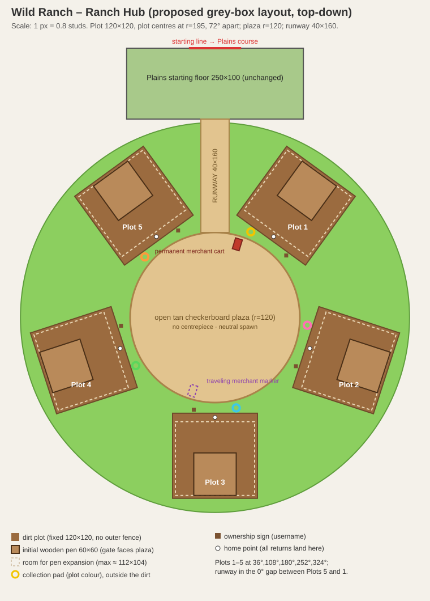

# Ranch Hub – Design & Implementation Proposal (rev. 2)

Status: **proposal for designer + ChatGPT review. Nothing in this document is implemented.**
Last updated: 2026-11-20. Layout diagram: [`ranch_hub_layout.svg`](ranch_hub_layout.svg).

Labels used below:
- **Confirmed** – designer decision; implement as written.
- **Provisional** – a starting number; easy to change in config and expected to be tuned in Studio.
- **Open** – undecided; needs a designer answer before the dependent stage.
- **Recommendation** – my suggestion; not a decision until approved.

---

## 1. Confirmed design decisions

**Server & plots**
- Maximum **5 players** per server; each player gets **one** ranch plot.
- Max Players is set to 5 in the experience settings (Studio / Creator Dashboard), **not** by script.
- Plots are **assigned on join** and **released on leave**. Ownership is **server-authoritative**;
  a player can manage only their own plot; everyone can see every ranch.

**Overall layout**
- The Ranch Hub and the Plains starting area form **one connected environment**; players spawn in the hub.
- **Five plots** surround an **open central plaza**; the **Plains runway** takes the sixth position
  and connects to the **existing Plains starting floor**.
- The existing **course, starting floor (250 × 1 × 100), starting line and course coordinate
  system are unchanged.**
- Plots are evenly distributed **72° apart**; each rectangular plot is **rotated to face the centre**;
  all entrances face the plaza; all plots have **equal size and equal access** to the plaza.
- The plaza stays **open – no fountain, water tower, windmill, well or other centrepiece.**

**Appearance** (reference images supplied by the designer)
- Bright, colourful, clean low-poly look; **tan checkerboard** plaza; **green grass** around the hub.
- Each plot is a **patch of brown dirt set into the grass**. **No outer fence around a plot** –
  the dirt itself marks the property.

**Animal pens**
- Each plot contains an **inner wooden-fenced enclosure** – the only permanent fencing on a plot.
- Pen upgrades **enlarge the enclosure**; the dirt plot never changes size; leave room to expand.
- Pen capacity, upgrade costs and milestones remain **undecided** (Phase 7).

**Ownership signs**
- A **small wooden sign near each plot entrance** shows the owner's **Roblox username**, updates when
  ownership changes, and clears when the plot is released.

**Merchants**
- **Permanent merchant:** a small western-style wooden stall or covered cart, **stationary and always
  available**, **near the runway entrance**, not blocking the runway or central walking paths;
  position adjustable in Studio.
- **Traveling merchant:** a separate limited-time event. **Reserve a location on the opposite side of
  the hub** from the permanent merchant, shown as a **simple ground marker**. No event logic yet.

**Returning home** (always the player's **own** plot – never another player's plot or a shared spawn)
- **Successful capture** → straight to the player's plot; the animal is added to inventory.
- **Stamina depletion / failed taming** → mount collapse + player fly-off → **white screen flash** →
  the player's plot.
- **Return to Ranch button** stays at the **Plains starting area** and teleports the player **near**
  their plot.

---

## 2. Geometry check of the provisional numbers

The provisional numbers were checked with a geometry script (corner-by-corner polygon distances in
the hub's own frame). **With plot centres at radius ≈ 140 the layout does not work:**

| Check (plots 120 × 120, centres at r = 140) | Result |
|---|---|
| Plot vs plot | **all 5 neighbouring pairs overlap** |
| Plot vs runway | **overlap** |
| Room for a central plaza | plots start at r = 80, leaving a plaza of only ~70 radius |

Why: five 120-stud-wide plots 72° apart need their inner corners at least ~143 studs from the centre
just to touch; adding a 40-stud runway through one of the gaps pushes that further.

**Recommendation – keep the 120 × 120 plot and 60 × 60 pen, move plot centres out to r = 195:**

| Check (recommended layout below) | Result |
|---|---|
| Plot vs plot | **no overlap; minimum gap 61.6 studs** (between neighbours' inner corners) |
| Plot vs plaza (r = 120) | **15 studs** of grass between plaza edge and every plot |
| Plot vs runway | **10.8 studs** clearance (Plots 1 and 5, nearest corners) |
| Plot vs existing starting floor | **38.4 studs** |
| Plot vs permanent merchant / traveling marker | **23.7 / 22.6 studs** |
| Permanent merchant vs runway | **11.9 studs**; vs nominal walking lines **4.5 studs** |
| Traveling marker vs nominal walking lines | **16.5 studs** |
| Both merchant spots inside the plaza | yes |
| Runway meets the floor's back edge | **exactly** (runway 40 × 160, from plaza edge r = 120 to r = 280) |
| Grass edge vs floor / course | grass ends 5 studs before the floor; nothing reaches the course |
| Pen expansion room | initial 60 × 60; **max ≈ 112 wide × 104 deep** inside the fixed plot |

*"Nominal walking lines" = a 40-wide line from the centre to the runway mouth and a 16-wide line from
the centre to each plot entrance, used only to check nothing blocks the obvious routes.*

---

## 3. Revised layout

### 3.1 Diagram


Text sketch (same layout; the floor is "up", Plains course beyond it):
```
                     PLAINS COURSE (unchanged) ▲
                ┌─────────── starting line ────────────┐
                │   Plains starting floor 250 × 100    │  ← back wall gets a 40-wide opening
                └─────────────────┬──┬─────────────────┘
          [Plot 5]                │RW│ runway 40 × 160        [Plot 1]
             dirt 120×120         │  │                     dirt 120×120
               ┌pen┐   ○ ▪      ┌─┴──┴─┐  [cart]     ○ ▪    ┌pen┐
                       ╲     ╱   open    ╲         ╱
          [Plot 4] ─ ○ ▪ ─  │  tan plaza  │  ─ ▪ ○ ─ [Plot 2]
                            │   r = 120   │
                             ╲ (spawn)   ╱
                    [trav. marker]   ○ ▪
                               [Plot 3]
        ○ collection pad (plot colour)   ▪ ownership sign   all on green grass, r = 275
```

### 3.2 Coordinate frame
- **Hub frame:** origin = hub centre; **+X points along the runway toward the starting floor** – the
  same direction as the course's forward (`LookVector` of the starting floor); Y = sideways.
- **Placement relative to the course (recommended):** the hub centre is **380 studs behind the
  starting line** on the course centre line (floor front edge = 0, floor back edge = −100, runway
  −100 … −260, plaza edge −260, hub centre −380). Everything is computed from the existing floor's
  CFrame, exactly like the course is today, so **the course, floor and starting line do not move**.
- Ground level: all hub ground surfaces sit **level with the top of the starting floor**.

### 3.3 Plot arrangement & orientation
- Plot directions (angle from the runway axis): **Plot 1 = 36°, Plot 2 = 108°, Plot 3 = 180°,
  Plot 4 = 252°, Plot 5 = 324°** – exactly 72° apart.
- The runway sits on the **0° line, in the gap between Plot 5 and Plot 1.** (See Open item O1:
  with 72° spacing the runway can't be a *sixth evenly spaced slot*; it uses one of the five gaps.)
- Each plot is rotated so its **front edge faces the centre**; front edge 135 studs from the centre,
  back edge 255; outermost corner 262.
- Plaza access is identical for every plot. Plots 1 and 5 are closer to the runway than the others –
  unavoidable with five plots and one runway.

### 3.4 Ground & plot appearance
| Surface | Look | Notes |
|---|---|---|
| Plaza (r = 120) | tan checkerboard, two close tan shades, slightly darker rim | built as a tiled grid so tile size/colours are config values |
| Runway (40 × 160) | same tan checkerboard | visually continues the plaza to the floor |
| Grass base (r = 275) | bright green | under/around everything; hub edge |
| Plots (120 × 120) | **brown dirt patch**, flush with the grass, **no outer fence** | one plot colour used only for its markers |
| Hub edge | **invisible walls** along the grass edge (except the runway) | stops players walking onto the baseplate / around the course (Recommendation R4) |

Plot colours (markers only, provisional): Yellow, Pink, Cyan, Green, Orange – from the reference image.

### 3.5 Inner animal pen
- **Initial pen: 60 × 60**, wooden post-and-rail fence (dark brown, like the reference), with a
  **gate facing the plaza**.
- **Recommendation:** anchor the pen **4 studs from the back of the plot** and centre it sideways, so
  upgrades grow it **toward the entrance and to the sides**. Maximum that fits: **≈ 112 × 104**,
  always leaving a **12-stud strip** at the front for the entrance, sign area and home point.
- Pen geometry is computed from a single "pen size" value per plot, so Phase 7 upgrades only change
  that value (no new layout code).
- Not implemented now: animals, capacity, upgrades, pen growth.

### 3.6 Plot entrance, sign, collection pad, home point
| Item | Proposed position (plot frame) | Notes |
|---|---|---|
| Entrance | middle of the plot's front (plaza-facing) edge | no fence – it's where the dirt meets the plaza grass |
| Ownership sign | on the grass strip in front of the plot, 30 studs to one side of the entrance | small wooden sign; text = owner's username |
| Collection pad | on the grass strip, 30 studs to the other side, ring of the plot's colour (10 diameter) | design notes put the pad **outside** the plot; function comes in Phase 7 |
| **Home point** | just inside the entrance (6 studs onto the dirt), facing the plaza | **every return lands here** (capture, collapse, Return to Ranch, respawn) |

### 3.7 Merchants
| | Position (recommended) | Footprint | Built as |
|---|---|---|---|
| **Permanent merchant** | in the plaza near the runway mouth: radius 108, 17° toward Plot 1 | ≈ 16 × 10 | simple wooden covered cart made of parts (wheels, canopy, counter) |
| **Traveling merchant (reserved)** | opposite side of the hub: radius 108, 197° (near Plot 3 / Plot 4) | ≈ 16 × 10 | flat ground marker only |

### 3.8 Runway connection to Plains
- Runway: **40 wide × 160 long**, from the plaza edge straight to the **centre of the starting floor's
  back edge**.
- The floor's existing **invisible back wall gets a 40-stud opening** where the runway meets it; the
  side walls, front walls, corridor opening, starting line and course are unchanged.
- Low invisible walls along both runway edges keep players on it.

---

## 4. Plot ownership & assignment architecture
- **`Shared/Rules/PlotAssignment.luau` (pure):** assign = **lowest free plot (1–5)**; release on leave;
  owner lookups; **return-destination resolution** (player → their plot's home point). Unit-tested.
- **`Server/Services/PlotService.luau`:**
  - assigns on `PlayerAdded`, releases on `PlayerRemoving`;
  - sets plot model attributes `OwnerUserId` / `OwnerName` (replicated, read-only for clients) and
    updates the sign;
  - API: `GetPlot(player)`, `GetHomeCFrame(player)`, `IsOwner(player, plotIndex)`,
    `WaitForPlot(player)`. **Every future plot action (placing animals, collecting, upgrades) must
    pass `IsOwner` on the server.**
- **Physical access:** any player may walk onto any plot (everyone can visit/see ranches);
  only management actions are owner-only.
- **No free plot:** cannot happen with Max Players = 5; defensive handling is Open item O7.

## 5. Return-to-plot behaviour (all run-ending scenarios)
One server function, `ReturnHome(player, reason)`, is the **only** way a player is sent home. It
resolves the player's **own** plot home point (never a shared spawn) and is used by:

| Scenario | Sequence | Available when |
|---|---|---|
| **Stamina depleted** | existing collapse (freeze + "Out of stamina", 3 s) → *fly-off (O3)* → **white screen flash** → own plot | Stage 5 (exists today, currently returns to the placeholder hub) |
| **Failed taming** | same collapse / fly-off / flash → own plot | Phase 6 (taming), calls `ReturnHome` |
| **Successful capture** | Capture & Return Home → **directly** to own plot; animal added to inventory | Phase 6 (capture), calls `ReturnHome` |
| **Return to Ranch button** | starting floor only → teleport near own plot (home point) | Stage 5 |
| **Respawn / first spawn** | engine spawn → immediately moved to own plot (see R3) | Stage 5 |

## 6. Recommended implementation sequence
Each stage ends with automated tests and a Studio check; nothing moves on until the stage passes.

| Stage | Scope | Depends on |
|---|---|---|
| **1. HubConfig + pure HubLayout** | all dimensions/colours/positions in `Shared/Config/HubConfig.luau`; `Shared/Rules/HubLayout.luau` computes plots, pens (from a pen-size value), entrances, signs, pads, home points, plaza, runway, merchant spots, hub edge, all from the floor CFrame. **Geometry tests.** | this proposal approved |
| **2. Build the hub (grey-box)** | WorldService builds grass base, checkerboard plaza + runway, 5 dirt plots, initial pens, signs (blank), pad rings, cart, traveling marker, hub-edge and runway walls; floor back-wall opening; placeholder hub removed. Role attributes on everything. | Stage 1 |
| **3. Plot assignment** | PlotAssignment + PlotService; owner attributes; signs show usernames; release on leave. | Stage 2 |
| **4. Walking transitions** | RunSessionService: Ranch ↔ StartingArea decided by position (starting floor vs hub); "Ride Plains" teleport and its remote removed; riding/validation unchanged. | Stage 2 |
| **5. Return to own plot** | `ReturnHome`; collapse → flash → own plot; Return to Ranch → own plot; respawn/first spawn → own plot. Capture / failed taming hook in later (Phase 6). | Stages 3–4 |

Out of scope (stay in their roadmap phases): animal placement & wandering, inventory gameplay,
passive income, pen upgrades, shop functionality at the cart, traveling-merchant event, leaderboards.

## 7. Automated testing requirements
| Stage | Tests |
|---|---|
| 1 | five unique plot positions, 72° apart, facing the centre; equal plot sizes; **no plot overlap**; **minimum gap ≥ configured value**; plots clear of plaza, runway, merchant spots and starting floor; **runway meets the floor's back edge exactly** and is centred on the course line; hub stays behind the floor (no overlap with the course); initial pen inside its plot; **maximum pen still inside the plot with the front strip free**; home point/sign/pad positions per plot; layout is deterministic (same inputs → same output) and works for a rotated/offset floor |
| 3 | assign lowest free plot; 5 players → 5 distinct plots; release on leave and re-use; no double assignment; correct player ↔ plot ownership; `IsOwner` false for other players' plots; sixth-player case per O7 |
| 4 | zone classification (hub / runway → Ranch, starting floor → StartingArea, past line → run starts) using the existing course-space maths |
| 5 | **return destination resolves to the player's own plot** for every reason; never the shared spawn; never another player's plot; respawn during a run still ends at own plot (existing RunSessionState rules kept) |
| all | the existing 90 tests keep passing |

## 8. Roblox Studio configuration requirements
- **Max Players = 5**: Creator Dashboard → your experience → Places → (this place) → Configure /
  Server size, or Studio → Game Settings → Places (requires the place to be published).
- Rojo connected (`rojo serve` from the repo root) and Studio API access still enabled for data.
- Multiplayer checks use **Test → Clients and Servers** with 2–5 players.
- If you place your own `StartingFloor` part, keep its name; the hub is built relative to it.

---

## 9. Remaining open decisions
| # | Decision | Needed by |
|---|---|---|
| **O1** | 72° plot spacing and a "sixth position" for the runway can't both be evenly spaced. **Proposed:** the runway sits in the gap between Plot 5 and Plot 1 (0° line). Confirm. | Stage 1 |
| **O2** | Approve the recommended dimensions: plot centres r = 195 (instead of ≈ 140), plaza r = 120, runway 40 × 160, grass r = 275, merchant spots at r = 108 / 17° and 197° (all provisional). | Stage 1 |
| **O3** | **The "existing collapse/fly-off sequence" does not exist yet**: today a collapse freezes the rider and shows "Out of stamina" for 3 s. Should the mount-collapse + fly-off animation be built now (grey-box), in Phase 6, or in Phase 13 (polish)? | Stage 5 |
| O4 | White flash: duration/feel (recommend ~0.3 s fade-in, ~0.5 s fade-out, teleport at full white). | Stage 5 |
| O5 | Pen placement inside the plot: anchored at the back, growing toward the entrance (recommended) vs centred. | Stage 1 |
| O6 | Which side of the entrance gets the sign vs the collection pad (proposed: sign left, pad right, same for every plot). | Stage 2 |
| O7 | Defensive "no free plot" behaviour (should never happen with Max Players = 5): recommend log an error and keep the player in the plaza with a message, rather than kicking. | Stage 3 |
| O8 | Studio-adjustable positions – see risk R1. Choose: (a) edit `HubConfig` values only, or (b) **also** let Studio-placed override parts (e.g. `Workspace.HubOverrides.MerchantCart`) replace generated positions (recommended for the cart and traveling marker). | Stage 2 |
| O9 | Merchant cart & pens built from **Roblox parts styled like the reference** (recommended – no asset uploads) vs Blender meshes imported via the verified FBX pipeline. | Stage 2 |
| O10 | Should the "Return to Ranch" button appear on the runway too, or only on the starting floor (design notes: only the starting area – recommended: starting floor only)? | Stage 4 |

Still undecided elsewhere (unchanged): pen capacity/costs/milestones, collection-pad behaviour,
income, leaderboard placement (design notes put leaderboards "in the spawn area" – would need space
at the plaza edge without becoming a centrepiece).

## 10. Technical risks & conflicts with the current architecture
| # | Risk / conflict | Mitigation |
|---|---|---|
| **R1** | **WorldService rebuilds the world from config at every server start.** Hand edits to generated parts in Studio would be **lost on the next Play**. This conflicts with "the designer will adjust visuals directly in Studio" unless handled. | All positions/sizes/colours in `HubConfig` (Rojo-synced) + optional Studio override parts (O8). Reuse the existing "reuse if present" pattern (as with `StartingFloor`). |
| R2 | Current Ranch ↔ StartingArea changes are **button-driven teleports** (`RequestTravelToBiome`). | Stage 4 replaces them with position-based zones; the run-start line check, speed validation and stamina are untouched. |
| R3 | Roblox always spawns a character at a `SpawnLocation` first. | Keep one neutral spawn in the plaza; `ReturnHome` moves the player to their plot as soon as the plot is known (`WaitForPlot`). The player may be visible in the plaza for a moment. |
| R4 | Players walking freely could leave the hub (e.g. onto the Baseplate) and wander beside the course. | Invisible walls at the grass edge and along the runway; the course itself is already enclosed. |
| R5 | The Phase 3 placeholder hub (`RanchSpawn`, `GreyBox.HubSize`, `HubDistanceBehindFloor`) and the "Ride Plains" button/remote become obsolete. | Remove them in Stages 2/4; document; Savannah access returns with the Phase 9 level select. |
| R6 | Plots are per server, not saved; a rejoining player may get a different plot. | Expected – animals are saved to the profile, not to a plot index. |
| R7 | Part count / mobile performance (checkerboard tiles, fence posts). | Tile the plaza with a modest grid (or a texture later); build fence sides as a few long rails + posts; anchored, no collision on decorative bits. |
| R8 | Design notes say the Return to Ranch button appears **only in a starting area** – now the starting floor is part of the hub. | Treat the **starting floor** as Plains' starting area (O10). |

## 11. Roadmap changes needed (Section C of ARCHITECTURE.md)
1. **Insert "Phase 3B – Ranch Hub environment & plot ownership"** between Phase 3 and Phase 4, with
   Stages 1–5 above and their tests.
2. **Phase 7** keeps: place/pick up animals, roaming, capacity, collection-pad function, income, pen
   upgrades. **Move "plot assignment" from Phase 7 to Phase 3B.**
3. **Phase 6** (taming): capture and failed taming call `ReturnHome` (white flash for failure).
4. **Phase 9**: the starting-area shop becomes the **permanent merchant cart** in the hub; Savannah
   access via the level select replaces the removed "Ride Plains" teleport.
5. **New later item:** traveling-merchant limited-time event at the reserved marker.
6. **Phase 12**: leaderboard placement must respect the open-plaza rule.
7. Decision log entries for every approved item in §1 and the answers to §9.
